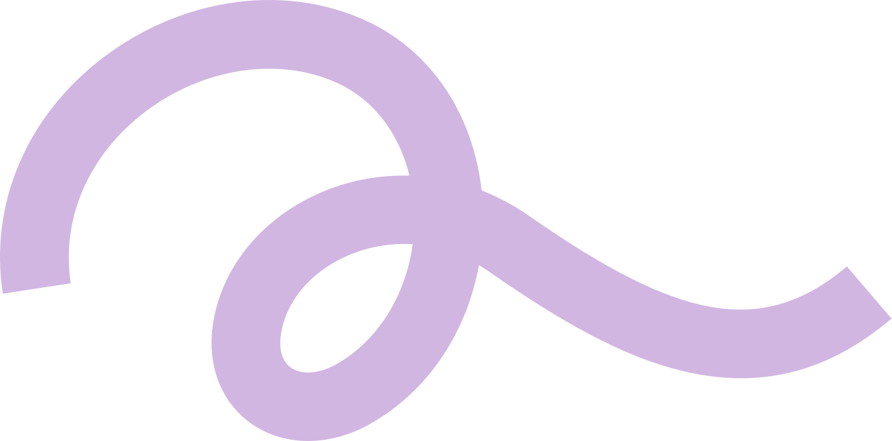
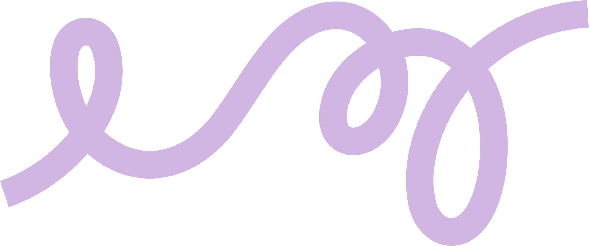
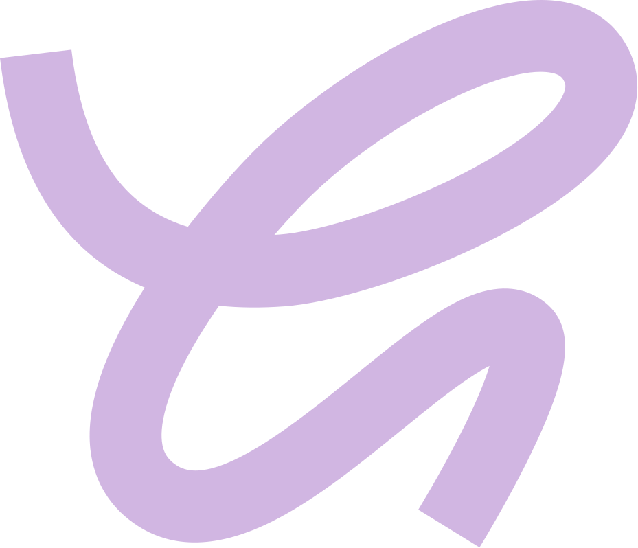
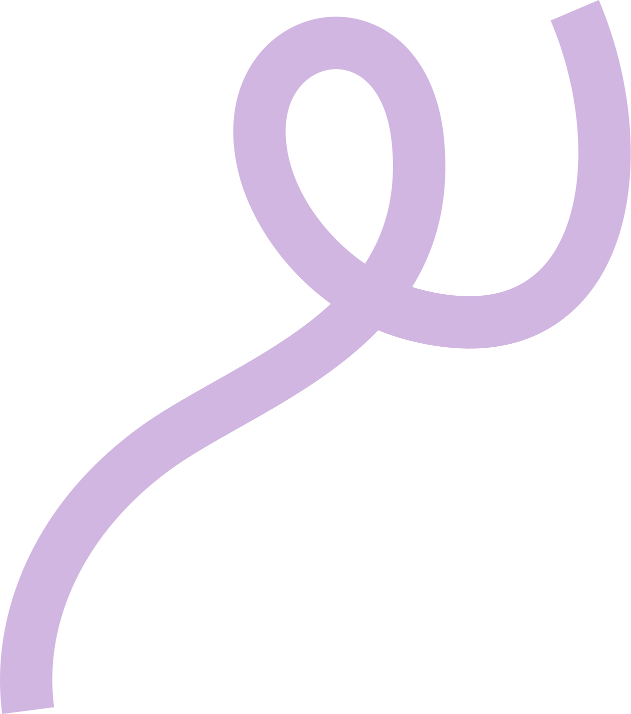
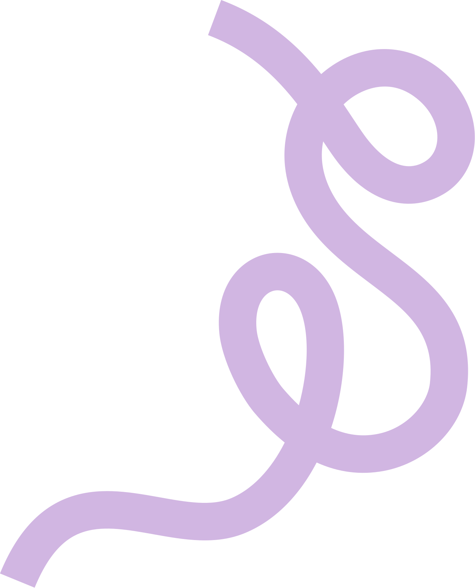
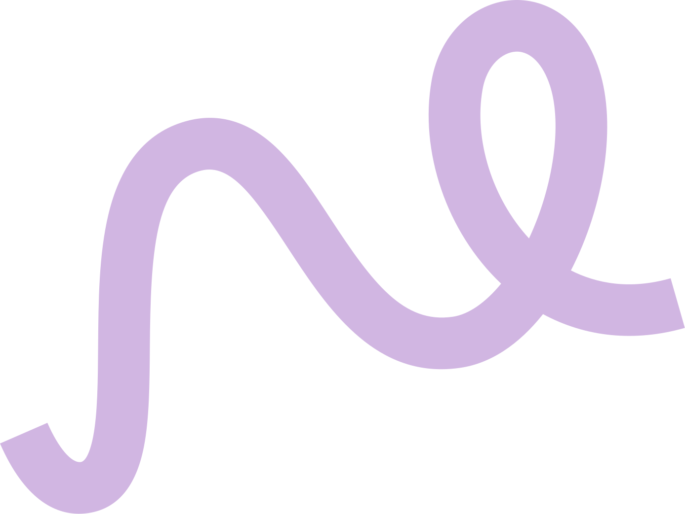
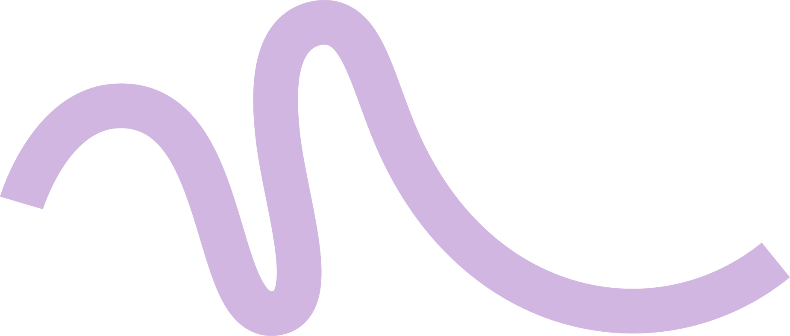
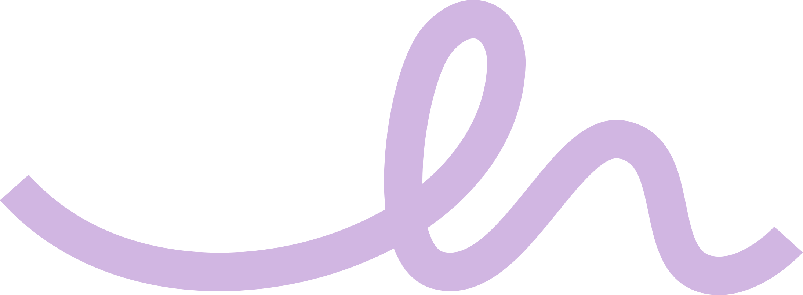
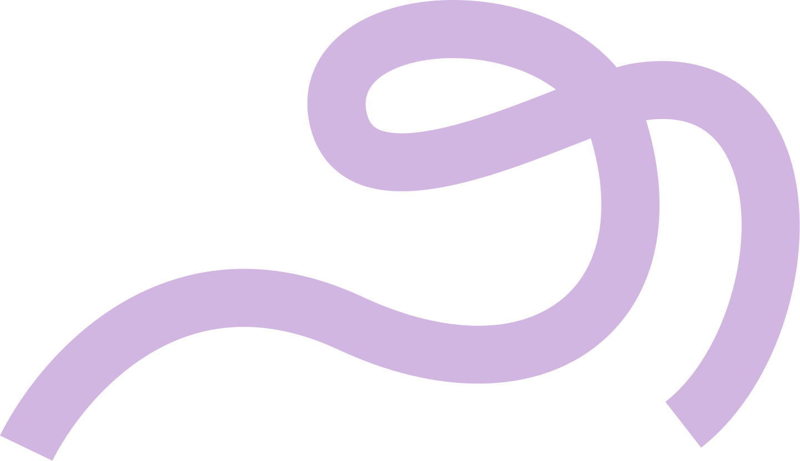

# Twig Network — Logos

Logos oficiais do Twig Network (preto e branco), em SVG e PNG, prontos para usar em HTML.

## Como usar em HTML

```html

```

Alternativa (GitHub Pages): `https://bxyqwhszpp-sys.github.io/twig-network-assets/logos/<arquivo>`

## Arquivos

| Arquivo | Link SVG | Link PNG |
|---|---|---|
| twig-logo-black | [svg](https://cdn.jsdelivr.net/gh/bxyqwhszpp-sys/twig-network-assets@main/logos/twig-logo-black.svg) | [png](https://cdn.jsdelivr.net/gh/bxyqwhszpp-sys/twig-network-assets@main/logos/twig-logo-black.png) |
| twig-logo-white | [svg](https://cdn.jsdelivr.net/gh/bxyqwhszpp-sys/twig-network-assets@main/logos/twig-logo-white.svg) | [png](https://cdn.jsdelivr.net/gh/bxyqwhszpp-sys/twig-network-assets@main/logos/twig-logo-white.png) |
| twig-network-horizontal-black | [svg](https://cdn.jsdelivr.net/gh/bxyqwhszpp-sys/twig-network-assets@main/logos/twig-network-horizontal-black.svg) | [png](https://cdn.jsdelivr.net/gh/bxyqwhszpp-sys/twig-network-assets@main/logos/twig-network-horizontal-black.png) |
| twig-network-horizontal-white | [svg](https://cdn.jsdelivr.net/gh/bxyqwhszpp-sys/twig-network-assets@main/logos/twig-network-horizontal-white.svg) | [png](https://cdn.jsdelivr.net/gh/bxyqwhszpp-sys/twig-network-assets@main/logos/twig-network-horizontal-white.png) |
| twig-network-stacked-centered-black | [svg](https://cdn.jsdelivr.net/gh/bxyqwhszpp-sys/twig-network-assets@main/logos/twig-network-stacked-centered-black.svg) | [png](https://cdn.jsdelivr.net/gh/bxyqwhszpp-sys/twig-network-assets@main/logos/twig-network-stacked-centered-black.png) |
| twig-network-stacked-centered-white | [svg](https://cdn.jsdelivr.net/gh/bxyqwhszpp-sys/twig-network-assets@main/logos/twig-network-stacked-centered-white.svg) | [png](https://cdn.jsdelivr.net/gh/bxyqwhszpp-sys/twig-network-assets@main/logos/twig-network-stacked-centered-white.png) |
| twig-network-stacked-left-black | [svg](https://cdn.jsdelivr.net/gh/bxyqwhszpp-sys/twig-network-assets@main/logos/twig-network-stacked-left-black.svg) | [png](https://cdn.jsdelivr.net/gh/bxyqwhszpp-sys/twig-network-assets@main/logos/twig-network-stacked-left-black.png) |
| twig-network-stacked-left-white | [svg](https://cdn.jsdelivr.net/gh/bxyqwhszpp-sys/twig-network-assets@main/logos/twig-network-stacked-left-white.svg) | [png](https://cdn.jsdelivr.net/gh/bxyqwhszpp-sys/twig-network-assets@main/logos/twig-network-stacked-left-white.png) |

_Versões `white` são para fundos escuros; `black` para fundos claros._

## Fitas (PNG, para e-mails)

Cada fita existe em 4 cores do Twig: `verde` (#a8b93a), `roxo` (#9954c8), `lilas` (#d1b6e2) e `branco` (#ffffff, para fundo escuro).
Nome: `fitas/fita-NN-COR.png` (ex.: `fita-10-roxo.png`).

```html

```

| Fita | Verde | Roxo | Lilás | Branco |
|---|---|---|---|---|
| fita-02 | [](https://cdn.jsdelivr.net/gh/bxyqwhszpp-sys/twig-network-assets@main/fitas/fita-02-verde.png) | [](https://cdn.jsdelivr.net/gh/bxyqwhszpp-sys/twig-network-assets@main/fitas/fita-02-roxo.png) | [](https://cdn.jsdelivr.net/gh/bxyqwhszpp-sys/twig-network-assets@main/fitas/fita-02-lilas.png) | [](https://cdn.jsdelivr.net/gh/bxyqwhszpp-sys/twig-network-assets@main/fitas/fita-02-branco.png) |
| fita-03 | [](https://cdn.jsdelivr.net/gh/bxyqwhszpp-sys/twig-network-assets@main/fitas/fita-03-verde.png) | [](https://cdn.jsdelivr.net/gh/bxyqwhszpp-sys/twig-network-assets@main/fitas/fita-03-roxo.png) | [](https://cdn.jsdelivr.net/gh/bxyqwhszpp-sys/twig-network-assets@main/fitas/fita-03-lilas.png) | [](https://cdn.jsdelivr.net/gh/bxyqwhszpp-sys/twig-network-assets@main/fitas/fita-03-branco.png) |
| fita-04 | [](https://cdn.jsdelivr.net/gh/bxyqwhszpp-sys/twig-network-assets@main/fitas/fita-04-verde.png) | [](https://cdn.jsdelivr.net/gh/bxyqwhszpp-sys/twig-network-assets@main/fitas/fita-04-roxo.png) | [](https://cdn.jsdelivr.net/gh/bxyqwhszpp-sys/twig-network-assets@main/fitas/fita-04-lilas.png) | [](https://cdn.jsdelivr.net/gh/bxyqwhszpp-sys/twig-network-assets@main/fitas/fita-04-branco.png) |
| fita-05 | [](https://cdn.jsdelivr.net/gh/bxyqwhszpp-sys/twig-network-assets@main/fitas/fita-05-verde.png) | [](https://cdn.jsdelivr.net/gh/bxyqwhszpp-sys/twig-network-assets@main/fitas/fita-05-roxo.png) | [](https://cdn.jsdelivr.net/gh/bxyqwhszpp-sys/twig-network-assets@main/fitas/fita-05-lilas.png) | [](https://cdn.jsdelivr.net/gh/bxyqwhszpp-sys/twig-network-assets@main/fitas/fita-05-branco.png) |
| fita-06 | [](https://cdn.jsdelivr.net/gh/bxyqwhszpp-sys/twig-network-assets@main/fitas/fita-06-verde.png) | [](https://cdn.jsdelivr.net/gh/bxyqwhszpp-sys/twig-network-assets@main/fitas/fita-06-roxo.png) | [](https://cdn.jsdelivr.net/gh/bxyqwhszpp-sys/twig-network-assets@main/fitas/fita-06-lilas.png) | [](https://cdn.jsdelivr.net/gh/bxyqwhszpp-sys/twig-network-assets@main/fitas/fita-06-branco.png) |
| fita-07 | [](https://cdn.jsdelivr.net/gh/bxyqwhszpp-sys/twig-network-assets@main/fitas/fita-07-verde.png) | [](https://cdn.jsdelivr.net/gh/bxyqwhszpp-sys/twig-network-assets@main/fitas/fita-07-roxo.png) | [](https://cdn.jsdelivr.net/gh/bxyqwhszpp-sys/twig-network-assets@main/fitas/fita-07-lilas.png) | [](https://cdn.jsdelivr.net/gh/bxyqwhszpp-sys/twig-network-assets@main/fitas/fita-07-branco.png) |
| fita-08 | [](https://cdn.jsdelivr.net/gh/bxyqwhszpp-sys/twig-network-assets@main/fitas/fita-08-verde.png) | [](https://cdn.jsdelivr.net/gh/bxyqwhszpp-sys/twig-network-assets@main/fitas/fita-08-roxo.png) | [](https://cdn.jsdelivr.net/gh/bxyqwhszpp-sys/twig-network-assets@main/fitas/fita-08-lilas.png) | [](https://cdn.jsdelivr.net/gh/bxyqwhszpp-sys/twig-network-assets@main/fitas/fita-08-branco.png) |
| fita-09 | [](https://cdn.jsdelivr.net/gh/bxyqwhszpp-sys/twig-network-assets@main/fitas/fita-09-verde.png) | [](https://cdn.jsdelivr.net/gh/bxyqwhszpp-sys/twig-network-assets@main/fitas/fita-09-roxo.png) | [](https://cdn.jsdelivr.net/gh/bxyqwhszpp-sys/twig-network-assets@main/fitas/fita-09-lilas.png) | [](https://cdn.jsdelivr.net/gh/bxyqwhszpp-sys/twig-network-assets@main/fitas/fita-09-branco.png) |
| fita-10 | [](https://cdn.jsdelivr.net/gh/bxyqwhszpp-sys/twig-network-assets@main/fitas/fita-10-verde.png) | [](https://cdn.jsdelivr.net/gh/bxyqwhszpp-sys/twig-network-assets@main/fitas/fita-10-roxo.png) | [](https://cdn.jsdelivr.net/gh/bxyqwhszpp-sys/twig-network-assets@main/fitas/fita-10-lilas.png) | [](https://cdn.jsdelivr.net/gh/bxyqwhszpp-sys/twig-network-assets@main/fitas/fita-10-branco.png) |
| fita-11 | [](https://cdn.jsdelivr.net/gh/bxyqwhszpp-sys/twig-network-assets@main/fitas/fita-11-verde.png) | [](https://cdn.jsdelivr.net/gh/bxyqwhszpp-sys/twig-network-assets@main/fitas/fita-11-roxo.png) | [](https://cdn.jsdelivr.net/gh/bxyqwhszpp-sys/twig-network-assets@main/fitas/fita-11-lilas.png) | [](https://cdn.jsdelivr.net/gh/bxyqwhszpp-sys/twig-network-assets@main/fitas/fita-11-branco.png) |
| fita-12 | [](https://cdn.jsdelivr.net/gh/bxyqwhszpp-sys/twig-network-assets@main/fitas/fita-12-verde.png) | [](https://cdn.jsdelivr.net/gh/bxyqwhszpp-sys/twig-network-assets@main/fitas/fita-12-roxo.png) | [](https://cdn.jsdelivr.net/gh/bxyqwhszpp-sys/twig-network-assets@main/fitas/fita-12-lilas.png) | [](https://cdn.jsdelivr.net/gh/bxyqwhszpp-sys/twig-network-assets@main/fitas/fita-12-branco.png) |
| fita-13 | [](https://cdn.jsdelivr.net/gh/bxyqwhszpp-sys/twig-network-assets@main/fitas/fita-13-verde.png) | [](https://cdn.jsdelivr.net/gh/bxyqwhszpp-sys/twig-network-assets@main/fitas/fita-13-roxo.png) | [](https://cdn.jsdelivr.net/gh/bxyqwhszpp-sys/twig-network-assets@main/fitas/fita-13-lilas.png) | [](https://cdn.jsdelivr.net/gh/bxyqwhszpp-sys/twig-network-assets@main/fitas/fita-13-branco.png) |
| fita-14 | [](https://cdn.jsdelivr.net/gh/bxyqwhszpp-sys/twig-network-assets@main/fitas/fita-14-verde.png) | [](https://cdn.jsdelivr.net/gh/bxyqwhszpp-sys/twig-network-assets@main/fitas/fita-14-roxo.png) | [](https://cdn.jsdelivr.net/gh/bxyqwhszpp-sys/twig-network-assets@main/fitas/fita-14-lilas.png) | [](https://cdn.jsdelivr.net/gh/bxyqwhszpp-sys/twig-network-assets@main/fitas/fita-14-branco.png) |
| fita-15 | [](https://cdn.jsdelivr.net/gh/bxyqwhszpp-sys/twig-network-assets@main/fitas/fita-15-verde.png) | [](https://cdn.jsdelivr.net/gh/bxyqwhszpp-sys/twig-network-assets@main/fitas/fita-15-roxo.png) | [](https://cdn.jsdelivr.net/gh/bxyqwhszpp-sys/twig-network-assets@main/fitas/fita-15-lilas.png) | [](https://cdn.jsdelivr.net/gh/bxyqwhszpp-sys/twig-network-assets@main/fitas/fita-15-branco.png) |
| fita-16 | [](https://cdn.jsdelivr.net/gh/bxyqwhszpp-sys/twig-network-assets@main/fitas/fita-16-verde.png) | [](https://cdn.jsdelivr.net/gh/bxyqwhszpp-sys/twig-network-assets@main/fitas/fita-16-roxo.png) | [](https://cdn.jsdelivr.net/gh/bxyqwhszpp-sys/twig-network-assets@main/fitas/fita-16-lilas.png) | [](https://cdn.jsdelivr.net/gh/bxyqwhszpp-sys/twig-network-assets@main/fitas/fita-16-branco.png) |
| fita-17 | [](https://cdn.jsdelivr.net/gh/bxyqwhszpp-sys/twig-network-assets@main/fitas/fita-17-verde.png) | [](https://cdn.jsdelivr.net/gh/bxyqwhszpp-sys/twig-network-assets@main/fitas/fita-17-roxo.png) | [](https://cdn.jsdelivr.net/gh/bxyqwhszpp-sys/twig-network-assets@main/fitas/fita-17-lilas.png) | [](https://cdn.jsdelivr.net/gh/bxyqwhszpp-sys/twig-network-assets@main/fitas/fita-17-branco.png) |
| fita-18 | [](https://cdn.jsdelivr.net/gh/bxyqwhszpp-sys/twig-network-assets@main/fitas/fita-18-verde.png) | [](https://cdn.jsdelivr.net/gh/bxyqwhszpp-sys/twig-network-assets@main/fitas/fita-18-roxo.png) | [](https://cdn.jsdelivr.net/gh/bxyqwhszpp-sys/twig-network-assets@main/fitas/fita-18-lilas.png) | [](https://cdn.jsdelivr.net/gh/bxyqwhszpp-sys/twig-network-assets@main/fitas/fita-18-branco.png) |
| fita-19 | [](https://cdn.jsdelivr.net/gh/bxyqwhszpp-sys/twig-network-assets@main/fitas/fita-19-verde.png) | [](https://cdn.jsdelivr.net/gh/bxyqwhszpp-sys/twig-network-assets@main/fitas/fita-19-roxo.png) | [](https://cdn.jsdelivr.net/gh/bxyqwhszpp-sys/twig-network-assets@main/fitas/fita-19-lilas.png) | [](https://cdn.jsdelivr.net/gh/bxyqwhszpp-sys/twig-network-assets@main/fitas/fita-19-branco.png) |
