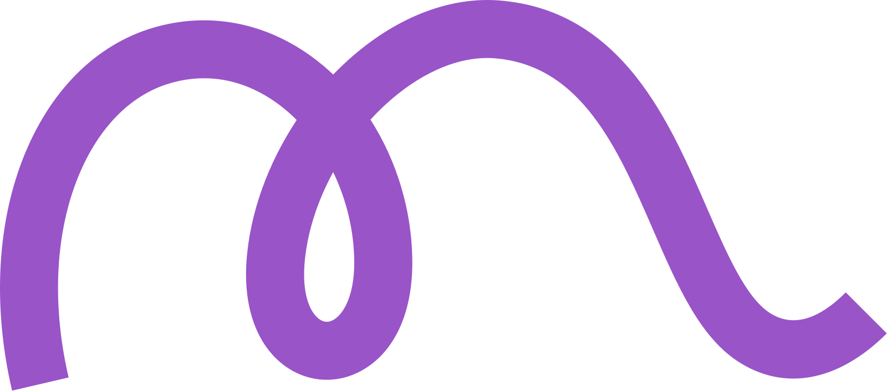

# Twig Network — Logos

Logos oficiais do Twig Network (preto e branco), em SVG e PNG, prontos para usar em HTML.

## Como usar em HTML

```html

```

Alternativa (GitHub Pages): `https://bxyqwhszpp-sys.github.io/twig-network-assets/logos/<arquivo>`

## Arquivos

| Arquivo | Link SVG | Link PNG |
|---|---|---|
| twig-logo-black | [svg](https://cdn.jsdelivr.net/gh/bxyqwhszpp-sys/twig-network-assets@main/logos/twig-logo-black.svg) | [png](https://cdn.jsdelivr.net/gh/bxyqwhszpp-sys/twig-network-assets@main/logos/twig-logo-black.png) |
| twig-logo-white | [svg](https://cdn.jsdelivr.net/gh/bxyqwhszpp-sys/twig-network-assets@main/logos/twig-logo-white.svg) | [png](https://cdn.jsdelivr.net/gh/bxyqwhszpp-sys/twig-network-assets@main/logos/twig-logo-white.png) |
| twig-network-horizontal-black | [svg](https://cdn.jsdelivr.net/gh/bxyqwhszpp-sys/twig-network-assets@main/logos/twig-network-horizontal-black.svg) | [png](https://cdn.jsdelivr.net/gh/bxyqwhszpp-sys/twig-network-assets@main/logos/twig-network-horizontal-black.png) |
| twig-network-horizontal-white | [svg](https://cdn.jsdelivr.net/gh/bxyqwhszpp-sys/twig-network-assets@main/logos/twig-network-horizontal-white.svg) | [png](https://cdn.jsdelivr.net/gh/bxyqwhszpp-sys/twig-network-assets@main/logos/twig-network-horizontal-white.png) |
| twig-network-stacked-centered-black | [svg](https://cdn.jsdelivr.net/gh/bxyqwhszpp-sys/twig-network-assets@main/logos/twig-network-stacked-centered-black.svg) | [png](https://cdn.jsdelivr.net/gh/bxyqwhszpp-sys/twig-network-assets@main/logos/twig-network-stacked-centered-black.png) |
| twig-network-stacked-centered-white | [svg](https://cdn.jsdelivr.net/gh/bxyqwhszpp-sys/twig-network-assets@main/logos/twig-network-stacked-centered-white.svg) | [png](https://cdn.jsdelivr.net/gh/bxyqwhszpp-sys/twig-network-assets@main/logos/twig-network-stacked-centered-white.png) |
| twig-network-stacked-left-black | [svg](https://cdn.jsdelivr.net/gh/bxyqwhszpp-sys/twig-network-assets@main/logos/twig-network-stacked-left-black.svg) | [png](https://cdn.jsdelivr.net/gh/bxyqwhszpp-sys/twig-network-assets@main/logos/twig-network-stacked-left-black.png) |
| twig-network-stacked-left-white | [svg](https://cdn.jsdelivr.net/gh/bxyqwhszpp-sys/twig-network-assets@main/logos/twig-network-stacked-left-white.svg) | [png](https://cdn.jsdelivr.net/gh/bxyqwhszpp-sys/twig-network-assets@main/logos/twig-network-stacked-left-white.png) |

_Versões `white` são para fundos escuros; `black` para fundos claros._

## Fitas (PNG, para e-mails)

Cada fita existe nas 6 cores principais da paleta Twig (Color Reference):

| Nome | Cor |
|---|---|
| `verde` | #A8B93A (principal) |
| `roxo` | #9954C8 |
| `azul` | #345C82 |
| `bege` | #F1E7CE |
| `branco` | #F3F4EE |
| `cinza` | #383A3D |

Nome do arquivo: `fitas/fita-NN-COR.png` (NN de 02 a 19). Ex.: `fita-10-azul.png`

```html

```

| Fita | Verde | Roxo | Azul | Bege | Branco | Cinza |
|---|---|---|---|---|---|---|
| fita-02 | [](https://cdn.jsdelivr.net/gh/bxyqwhszpp-sys/twig-network-assets@main/fitas/fita-02-verde.png) | [](https://cdn.jsdelivr.net/gh/bxyqwhszpp-sys/twig-network-assets@main/fitas/fita-02-roxo.png) | [](https://cdn.jsdelivr.net/gh/bxyqwhszpp-sys/twig-network-assets@main/fitas/fita-02-azul.png) | [](https://cdn.jsdelivr.net/gh/bxyqwhszpp-sys/twig-network-assets@main/fitas/fita-02-bege.png) | [](https://cdn.jsdelivr.net/gh/bxyqwhszpp-sys/twig-network-assets@main/fitas/fita-02-branco.png) | [](https://cdn.jsdelivr.net/gh/bxyqwhszpp-sys/twig-network-assets@main/fitas/fita-02-cinza.png) |
| fita-03 | [](https://cdn.jsdelivr.net/gh/bxyqwhszpp-sys/twig-network-assets@main/fitas/fita-03-verde.png) | [](https://cdn.jsdelivr.net/gh/bxyqwhszpp-sys/twig-network-assets@main/fitas/fita-03-roxo.png) | [](https://cdn.jsdelivr.net/gh/bxyqwhszpp-sys/twig-network-assets@main/fitas/fita-03-azul.png) | [](https://cdn.jsdelivr.net/gh/bxyqwhszpp-sys/twig-network-assets@main/fitas/fita-03-bege.png) | [](https://cdn.jsdelivr.net/gh/bxyqwhszpp-sys/twig-network-assets@main/fitas/fita-03-branco.png) | [](https://cdn.jsdelivr.net/gh/bxyqwhszpp-sys/twig-network-assets@main/fitas/fita-03-cinza.png) |
| fita-04 | [](https://cdn.jsdelivr.net/gh/bxyqwhszpp-sys/twig-network-assets@main/fitas/fita-04-verde.png) | [](https://cdn.jsdelivr.net/gh/bxyqwhszpp-sys/twig-network-assets@main/fitas/fita-04-roxo.png) | [](https://cdn.jsdelivr.net/gh/bxyqwhszpp-sys/twig-network-assets@main/fitas/fita-04-azul.png) | [](https://cdn.jsdelivr.net/gh/bxyqwhszpp-sys/twig-network-assets@main/fitas/fita-04-bege.png) | [](https://cdn.jsdelivr.net/gh/bxyqwhszpp-sys/twig-network-assets@main/fitas/fita-04-branco.png) | [](https://cdn.jsdelivr.net/gh/bxyqwhszpp-sys/twig-network-assets@main/fitas/fita-04-cinza.png) |
| fita-05 | [](https://cdn.jsdelivr.net/gh/bxyqwhszpp-sys/twig-network-assets@main/fitas/fita-05-verde.png) | [](https://cdn.jsdelivr.net/gh/bxyqwhszpp-sys/twig-network-assets@main/fitas/fita-05-roxo.png) | [](https://cdn.jsdelivr.net/gh/bxyqwhszpp-sys/twig-network-assets@main/fitas/fita-05-azul.png) | [](https://cdn.jsdelivr.net/gh/bxyqwhszpp-sys/twig-network-assets@main/fitas/fita-05-bege.png) | [](https://cdn.jsdelivr.net/gh/bxyqwhszpp-sys/twig-network-assets@main/fitas/fita-05-branco.png) | [](https://cdn.jsdelivr.net/gh/bxyqwhszpp-sys/twig-network-assets@main/fitas/fita-05-cinza.png) |
| fita-06 | [](https://cdn.jsdelivr.net/gh/bxyqwhszpp-sys/twig-network-assets@main/fitas/fita-06-verde.png) | [](https://cdn.jsdelivr.net/gh/bxyqwhszpp-sys/twig-network-assets@main/fitas/fita-06-roxo.png) | [](https://cdn.jsdelivr.net/gh/bxyqwhszpp-sys/twig-network-assets@main/fitas/fita-06-azul.png) | [](https://cdn.jsdelivr.net/gh/bxyqwhszpp-sys/twig-network-assets@main/fitas/fita-06-bege.png) | [](https://cdn.jsdelivr.net/gh/bxyqwhszpp-sys/twig-network-assets@main/fitas/fita-06-branco.png) | [](https://cdn.jsdelivr.net/gh/bxyqwhszpp-sys/twig-network-assets@main/fitas/fita-06-cinza.png) |
| fita-07 | [](https://cdn.jsdelivr.net/gh/bxyqwhszpp-sys/twig-network-assets@main/fitas/fita-07-verde.png) | [](https://cdn.jsdelivr.net/gh/bxyqwhszpp-sys/twig-network-assets@main/fitas/fita-07-roxo.png) | [](https://cdn.jsdelivr.net/gh/bxyqwhszpp-sys/twig-network-assets@main/fitas/fita-07-azul.png) | [](https://cdn.jsdelivr.net/gh/bxyqwhszpp-sys/twig-network-assets@main/fitas/fita-07-bege.png) | [](https://cdn.jsdelivr.net/gh/bxyqwhszpp-sys/twig-network-assets@main/fitas/fita-07-branco.png) | [](https://cdn.jsdelivr.net/gh/bxyqwhszpp-sys/twig-network-assets@main/fitas/fita-07-cinza.png) |
| fita-08 | [](https://cdn.jsdelivr.net/gh/bxyqwhszpp-sys/twig-network-assets@main/fitas/fita-08-verde.png) | [](https://cdn.jsdelivr.net/gh/bxyqwhszpp-sys/twig-network-assets@main/fitas/fita-08-roxo.png) | [](https://cdn.jsdelivr.net/gh/bxyqwhszpp-sys/twig-network-assets@main/fitas/fita-08-azul.png) | [](https://cdn.jsdelivr.net/gh/bxyqwhszpp-sys/twig-network-assets@main/fitas/fita-08-bege.png) | [](https://cdn.jsdelivr.net/gh/bxyqwhszpp-sys/twig-network-assets@main/fitas/fita-08-branco.png) | [](https://cdn.jsdelivr.net/gh/bxyqwhszpp-sys/twig-network-assets@main/fitas/fita-08-cinza.png) |
| fita-09 | [](https://cdn.jsdelivr.net/gh/bxyqwhszpp-sys/twig-network-assets@main/fitas/fita-09-verde.png) | [](https://cdn.jsdelivr.net/gh/bxyqwhszpp-sys/twig-network-assets@main/fitas/fita-09-roxo.png) | [](https://cdn.jsdelivr.net/gh/bxyqwhszpp-sys/twig-network-assets@main/fitas/fita-09-azul.png) | [](https://cdn.jsdelivr.net/gh/bxyqwhszpp-sys/twig-network-assets@main/fitas/fita-09-bege.png) | [](https://cdn.jsdelivr.net/gh/bxyqwhszpp-sys/twig-network-assets@main/fitas/fita-09-branco.png) | [](https://cdn.jsdelivr.net/gh/bxyqwhszpp-sys/twig-network-assets@main/fitas/fita-09-cinza.png) |
| fita-10 | [](https://cdn.jsdelivr.net/gh/bxyqwhszpp-sys/twig-network-assets@main/fitas/fita-10-verde.png) | [](https://cdn.jsdelivr.net/gh/bxyqwhszpp-sys/twig-network-assets@main/fitas/fita-10-roxo.png) | [](https://cdn.jsdelivr.net/gh/bxyqwhszpp-sys/twig-network-assets@main/fitas/fita-10-azul.png) | [](https://cdn.jsdelivr.net/gh/bxyqwhszpp-sys/twig-network-assets@main/fitas/fita-10-bege.png) | [](https://cdn.jsdelivr.net/gh/bxyqwhszpp-sys/twig-network-assets@main/fitas/fita-10-branco.png) | [](https://cdn.jsdelivr.net/gh/bxyqwhszpp-sys/twig-network-assets@main/fitas/fita-10-cinza.png) |
| fita-11 | [](https://cdn.jsdelivr.net/gh/bxyqwhszpp-sys/twig-network-assets@main/fitas/fita-11-verde.png) | [](https://cdn.jsdelivr.net/gh/bxyqwhszpp-sys/twig-network-assets@main/fitas/fita-11-roxo.png) | [](https://cdn.jsdelivr.net/gh/bxyqwhszpp-sys/twig-network-assets@main/fitas/fita-11-azul.png) | [](https://cdn.jsdelivr.net/gh/bxyqwhszpp-sys/twig-network-assets@main/fitas/fita-11-bege.png) | [](https://cdn.jsdelivr.net/gh/bxyqwhszpp-sys/twig-network-assets@main/fitas/fita-11-branco.png) | [](https://cdn.jsdelivr.net/gh/bxyqwhszpp-sys/twig-network-assets@main/fitas/fita-11-cinza.png) |
| fita-12 | [](https://cdn.jsdelivr.net/gh/bxyqwhszpp-sys/twig-network-assets@main/fitas/fita-12-verde.png) | [](https://cdn.jsdelivr.net/gh/bxyqwhszpp-sys/twig-network-assets@main/fitas/fita-12-roxo.png) | [](https://cdn.jsdelivr.net/gh/bxyqwhszpp-sys/twig-network-assets@main/fitas/fita-12-azul.png) | [](https://cdn.jsdelivr.net/gh/bxyqwhszpp-sys/twig-network-assets@main/fitas/fita-12-bege.png) | [](https://cdn.jsdelivr.net/gh/bxyqwhszpp-sys/twig-network-assets@main/fitas/fita-12-branco.png) | [](https://cdn.jsdelivr.net/gh/bxyqwhszpp-sys/twig-network-assets@main/fitas/fita-12-cinza.png) |
| fita-13 | [](https://cdn.jsdelivr.net/gh/bxyqwhszpp-sys/twig-network-assets@main/fitas/fita-13-verde.png) | [](https://cdn.jsdelivr.net/gh/bxyqwhszpp-sys/twig-network-assets@main/fitas/fita-13-roxo.png) | [](https://cdn.jsdelivr.net/gh/bxyqwhszpp-sys/twig-network-assets@main/fitas/fita-13-azul.png) | [](https://cdn.jsdelivr.net/gh/bxyqwhszpp-sys/twig-network-assets@main/fitas/fita-13-bege.png) | [](https://cdn.jsdelivr.net/gh/bxyqwhszpp-sys/twig-network-assets@main/fitas/fita-13-branco.png) | [](https://cdn.jsdelivr.net/gh/bxyqwhszpp-sys/twig-network-assets@main/fitas/fita-13-cinza.png) |
| fita-14 | [](https://cdn.jsdelivr.net/gh/bxyqwhszpp-sys/twig-network-assets@main/fitas/fita-14-verde.png) | [](https://cdn.jsdelivr.net/gh/bxyqwhszpp-sys/twig-network-assets@main/fitas/fita-14-roxo.png) | [](https://cdn.jsdelivr.net/gh/bxyqwhszpp-sys/twig-network-assets@main/fitas/fita-14-azul.png) | [](https://cdn.jsdelivr.net/gh/bxyqwhszpp-sys/twig-network-assets@main/fitas/fita-14-bege.png) | [](https://cdn.jsdelivr.net/gh/bxyqwhszpp-sys/twig-network-assets@main/fitas/fita-14-branco.png) | [](https://cdn.jsdelivr.net/gh/bxyqwhszpp-sys/twig-network-assets@main/fitas/fita-14-cinza.png) |
| fita-15 | [](https://cdn.jsdelivr.net/gh/bxyqwhszpp-sys/twig-network-assets@main/fitas/fita-15-verde.png) | [](https://cdn.jsdelivr.net/gh/bxyqwhszpp-sys/twig-network-assets@main/fitas/fita-15-roxo.png) | [](https://cdn.jsdelivr.net/gh/bxyqwhszpp-sys/twig-network-assets@main/fitas/fita-15-azul.png) | [](https://cdn.jsdelivr.net/gh/bxyqwhszpp-sys/twig-network-assets@main/fitas/fita-15-bege.png) | [](https://cdn.jsdelivr.net/gh/bxyqwhszpp-sys/twig-network-assets@main/fitas/fita-15-branco.png) | [](https://cdn.jsdelivr.net/gh/bxyqwhszpp-sys/twig-network-assets@main/fitas/fita-15-cinza.png) |
| fita-16 | [](https://cdn.jsdelivr.net/gh/bxyqwhszpp-sys/twig-network-assets@main/fitas/fita-16-verde.png) | [](https://cdn.jsdelivr.net/gh/bxyqwhszpp-sys/twig-network-assets@main/fitas/fita-16-roxo.png) | [](https://cdn.jsdelivr.net/gh/bxyqwhszpp-sys/twig-network-assets@main/fitas/fita-16-azul.png) | [](https://cdn.jsdelivr.net/gh/bxyqwhszpp-sys/twig-network-assets@main/fitas/fita-16-bege.png) | [](https://cdn.jsdelivr.net/gh/bxyqwhszpp-sys/twig-network-assets@main/fitas/fita-16-branco.png) | [](https://cdn.jsdelivr.net/gh/bxyqwhszpp-sys/twig-network-assets@main/fitas/fita-16-cinza.png) |
| fita-17 | [](https://cdn.jsdelivr.net/gh/bxyqwhszpp-sys/twig-network-assets@main/fitas/fita-17-verde.png) | [](https://cdn.jsdelivr.net/gh/bxyqwhszpp-sys/twig-network-assets@main/fitas/fita-17-roxo.png) | [](https://cdn.jsdelivr.net/gh/bxyqwhszpp-sys/twig-network-assets@main/fitas/fita-17-azul.png) | [](https://cdn.jsdelivr.net/gh/bxyqwhszpp-sys/twig-network-assets@main/fitas/fita-17-bege.png) | [](https://cdn.jsdelivr.net/gh/bxyqwhszpp-sys/twig-network-assets@main/fitas/fita-17-branco.png) | [](https://cdn.jsdelivr.net/gh/bxyqwhszpp-sys/twig-network-assets@main/fitas/fita-17-cinza.png) |
| fita-18 | [](https://cdn.jsdelivr.net/gh/bxyqwhszpp-sys/twig-network-assets@main/fitas/fita-18-verde.png) | [](https://cdn.jsdelivr.net/gh/bxyqwhszpp-sys/twig-network-assets@main/fitas/fita-18-roxo.png) | [](https://cdn.jsdelivr.net/gh/bxyqwhszpp-sys/twig-network-assets@main/fitas/fita-18-azul.png) | [](https://cdn.jsdelivr.net/gh/bxyqwhszpp-sys/twig-network-assets@main/fitas/fita-18-bege.png) | [](https://cdn.jsdelivr.net/gh/bxyqwhszpp-sys/twig-network-assets@main/fitas/fita-18-branco.png) | [](https://cdn.jsdelivr.net/gh/bxyqwhszpp-sys/twig-network-assets@main/fitas/fita-18-cinza.png) |
| fita-19 | [](https://cdn.jsdelivr.net/gh/bxyqwhszpp-sys/twig-network-assets@main/fitas/fita-19-verde.png) | [](https://cdn.jsdelivr.net/gh/bxyqwhszpp-sys/twig-network-assets@main/fitas/fita-19-roxo.png) | [](https://cdn.jsdelivr.net/gh/bxyqwhszpp-sys/twig-network-assets@main/fitas/fita-19-azul.png) | [](https://cdn.jsdelivr.net/gh/bxyqwhszpp-sys/twig-network-assets@main/fitas/fita-19-bege.png) | [](https://cdn.jsdelivr.net/gh/bxyqwhszpp-sys/twig-network-assets@main/fitas/fita-19-branco.png) | [](https://cdn.jsdelivr.net/gh/bxyqwhszpp-sys/twig-network-assets@main/fitas/fita-19-cinza.png) |
